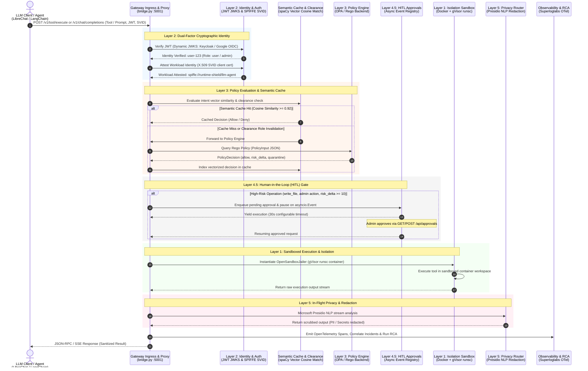

# Runtime Shield: Centralized LLM-Agnostic Runtime Governance for Agentic Systems


**Runtime Shield** is a high-performance, identity-aware security gateway providing **Centralized LLM-Agnostic Runtime Governance** for autonomous AI agents (such as LibreChat, Claude Desktop, LangChain/LlamaIndex ReAct loops, and custom agents). 

It acts as a stateful, unified interception gateway between AI clients and execution environments, enforcing **Zero-Trust** boundaries, cryptographically attested workload identities, semantic caching, human approval gates, containerized sandbox isolation, and real-time privacy controls.

---

##  Architecture Overview

The diagram below illustrates how an incoming tool call or chat completion traverses the Runtime Shield's defensive layers, semantic cache, OPA policy engine, and HITL approval queue before executing inside an isolated sandbox.



---

##  Multi-Layer Defense-in-Depth Mechanics

### 1. Layer 1: Infrastructure Isolation & OpenSandbox
- **Containerized Sandboxing:** Spawns tool execution inside dynamic container environments via [`OpenSandboxJailer`](file:///c:/Users/kavya/OneDrive/Desktop/Runtime-shield-for-agentic-systems/bridge.py) managed by `JailFactory`.
- **gVisor (`runsc`) Virtualization:** Integrates kernel-level virtualization to block direct host syscalls when available.
- **Path Isolation:** Mounts active workspace folders read-write while locking external shared paths and sensitive volumes to read-only mounts. Fallback support includes Windows Job Objects and Linux namespace jails.

### 2. Layer 2: Dual-Factor Identity & Cryptographic Auth
- **User Identity (JWKS Verification):** Dynamic RS256/HS256 JWT validation supporting:
  - **Keycloak IAM:** Dynamic realm signature and claims verification (`iss`, `exp`, `aud`, roles).
  - **Google OIDC / OAuth2:** Dynamically fetches Google's public JWKS certs (`https://www.googleapis.com/oauth2/v3/certs`) and maps emails against `GOOGLE_ADMIN_EMAILS` into fine-grained roles (`admin`, `privileged`, `user`).
- **Workload Identity (SPIFFE / SPIRE):** Validates X.509 SVID client certificates presented in headers (`X-SPIFFE-CERT`) attested against the local CA trust bundle (`ca.crt`).

### 3. Layer 3: Pluggable Policy Enforcement, Semantic Caching & Clearance Check
- **OPA / Rego Declarative Engine:** Standardizes every request into a unified `PolicyInput` schema evaluated against [`rules/runtime_shield.rego`](file:///c:/Users/kavya/OneDrive/Desktop/Runtime-shield-for-agentic-systems/rules/runtime_shield.rego).
- **Semantic Caching ([`SemanticCachePolicyEngine`](file:///c:/Users/kavya/OneDrive/Desktop/Runtime-shield-for-agentic-systems/src/policy_engine.py)):**
  - Uses local **spaCy** NLP (`en_core_web_sm`) to compute high-dimensional vector embeddings of incoming tool names, intents, and arguments.
  - Performs **Cosine Similarity** matching (threshold $\ge 0.92$) against indexed decisions to serve instant cache hits, minimizing latency.
- **Clearance Filter (Dynamic Invalidation):** Tracks user role state. If a user's clearance transitions (e.g. role upgraded from `user` to `admin`), all cached entries for that user are instantly invalidated to prevent privilege escalation.

### 4. Layer 4: Behavioral Fraud Engine & Circuit Breakers
- Tracks cumulative workload and user risk scores in real time, with score decay.
- Exposes **Honeypot Traps** (`get_system_config`, `fetch_internal_db`) as synthetic MCP tools. In protection mode, calls are denied without returning internal data, logged as critical dashboard events, and add 100 risk points per attempt.
- **Circuit Breaker:** At `QUARANTINE_THRESHOLD = 500`, the event is marked as bridge-level quarantine. Normal tool calls are denied once risk reaches 200 and remain blocked until the in-memory score decays below that threshold (10 points every 30 seconds). Scores do not survive a bridge restart, and this does not revoke a SPIFFE SVID.

### 5. Layer 4.5: Human-in-the-Loop (HITL) Approval System
- Intercepts sensitive or high-risk tool invocations (e.g., `write_file`, privilege changes, risk score $\ge 10$).
- Exchanges the requester token for a scoped JIT token before pausing a high-risk call, so the short-lived requester token does not expire while an administrator reviews it; then pauses execution asynchronously via `asyncio.Event` (configurable 180s timeout, fails closed on timeout).
- Standard users can request a `write_file` operation only inside `secure-experiment-zone/`; the gateway pauses it for an authenticated administrator. Policy-denied paths and protected files never reach the approval queue.
- Exposes approval APIs and dashboard controls:
  - `POST /api/approvals/session` — Exchanges Keycloak admin credentials for a verified access token.
  - `GET /api/approvals/pending` — Requires an administrator Bearer token; lists pending requests with tool arguments, risk scores, and user metadata.
  - `POST /api/approvals/{req_id}/action` — Requires an administrator Bearer token to approve, deny, or block an action.
- The demo dashboard serves over HTTP by default. Keep it on a trusted local network or put it behind HTTPS before exposing it beyond the local demo.

### 6. Layer 5: Privacy Router & PII Redaction
- In-flight JSON-aware and streaming PII scrubbing using **Microsoft Presidio NLP**.
- Redacts credit card numbers, SSNs, personal emails, phone numbers, and secrets before LLM ingestion or user display.
- The gateway pins its Presidio/spaCy dependencies and uses `en_core_web_sm`. Dashboard policy status reports whether Presidio or regex fallback is active; the fallback does not provide NLP-based PERSON detection.
- Administrator traffic intentionally bypasses PII redaction. Normal-user prompts are redacted before downstream processing, and tool/LLM responses are redacted before being returned.

### 7. Observability, OpenTelemetry & Superloglabs RCA
- **OpenTelemetry Standard:** Emits structured spans, traces, and metrics via `SuperloglabsExporter`.
- **Incident Correlation:** Aggregates repeated alerts within a 5-minute sliding window into unified incident records in SQLite (`telemetry.db`).
- **Automated Root Cause Analysis (RCA):** Analyzes blocked actions and policy violations to generate automated diagnostic reports and suggested PR patches.

---

##  Codebase Structure

```text
├── bridge.py                 # Core unified gateway, REST proxy, HITL endpoints & OpenSandbox jailer
├── telemetry.py              # OpenTelemetry exporter, incident correlation & RCA engine
├── login.py                  # Authentication CLI & mock token generator (Keycloak / Google)
├── run_security_drills.py    # Automated policy & security compliance test suite
├── mcp-firewall.yaml         # Operational firewall rules, tool definitions & scopes
├── Dockerfile                # Multi-stage production build (Node.js TypeScript + Python 3.11)
├── docker-compose.yml        # Orchestration for Keycloak, SPIRE, Gateway, and Chatbot
│
├── src/
│   ├── index.ts              # TypeScript MCP server entrypoint
│   ├── policy_engine.py      # OPA engine & SemanticCachePolicyEngine implementation
│   ├── opa_sync.py           # Syncs firewall rules into OPA JSON data
│   └── tools/                # Built-in tool implementations
│
├── rules/
│   ├── runtime_shield.rego   # Rego declarative policy rules for OPA
│   └── runtime_shield_data.json # Synchronized policy dataset
│
├── spire/                    # SPIFFE/SPIRE server, agent, and certificate configurations
└── document/                 # Deep-dive architecture and governance walkthroughs
```

---

##  Getting Started

### Prerequisites
- **Python 3.10+**
- **Node.js 18+**
- **Docker & Docker Compose**
- **SPIRE** (optional for local mock mode, required for full mTLS SVID attestation)

---

### Option A: Complete Docker Compose Deployment (Dokploy Ready)

#### Windows Quick Start

From PowerShell in a fresh checkout, prepare the local secrets and Keycloak TLS files:

```powershell
Copy-Item .env.example .env
# Fill required values in .env with unique local secrets and Keycloak client secrets.
python -m pip install -r requirements.txt
python .\generate_certs.py
python .\generate_keycloak_tls.py
```

Then, with Docker Desktop installed, start the demo:

```powershell
.\start_librechat_demo.ps1
```

The script starts Docker Desktop if needed, waits for its engine, creates the required network, generates a local LibreChat config containing the mounted LLM workload certificate, and prepares the private filesystem-provider token in the Git-ignored `.env` file. In a clean environment it builds and starts the stack, then opens LibreChat (`http://localhost:3080`) and the dashboard (`http://localhost:9090`). If the isolated workshop gateway/provider already exist, it reuses them and restarts only LibreChat, leaving the other gateway containers and Docker data untouched; that dashboard is at `http://localhost:9091`. Use this launcher rather than plain `docker compose up` for the demo so LibreChat sends the certificate required by strict SPIFFE verification. The generated `librechat.runtime.yaml` and provider token are local and ignored by Git. On the first clean deployment, allow a few minutes for the images to build. If the Docker engine does not come up, open Docker Desktop, switch to the Linux engine, and rerun the command.

To stop the stack later, run `docker compose down` from the repository folder.

#### Manual Deployment

Deploy the entire runtime stack (Keycloak, SPIRE Server, SPIRE Agent, Gateway, and Chatbot UI):

```bash
# 1. Clone repository
git clone https://github.com/rise-research-labs/Agentic-AI-Security.git
cd Agentic-AI-Security

# 2. Configure environment
cp .env.example .env
# Fill each required blank with a unique secret or the client secret from Keycloak.
# Generate JWT_SECRET, JWT_REFRESH_SECRET, OPENID_SESSION_SECRET, and
# RUNTIME_SHIELD_GATEWAY_API_KEY with a password manager or secure local generator.
# Set CREDS_KEY to 64 hex characters and CREDS_IV to 32 hex characters.
# Set the Keycloak client secrets after configuring their clients.
# start_librechat_demo.ps1 generates RUNTIME_SHIELD_FS_PROVIDER_TOKEN if it is blank.
# Never commit .env or paste its values into logs or chat.

# 3. Generate local SPIRE and Keycloak TLS files (ignored by Git)
python -m pip install -r requirements.txt
python generate_certs.py
python generate_keycloak_tls.py

# 4. Create network (if deploying on Dokploy or standalone)
docker network create dokploy-network || true

# 5. Launch all services
docker compose up --build -d
```

#### Running Services:
| Service | Port | Description |
| :--- | :--- | :--- |
| **Runtime Shield Gateway** | `5001` | REST proxy & tool execution gateway (`/v1/tool/execute`) |
| **Security Dashboard** | `9090` | Real-time monitoring & HITL approvals |
| **SSE Bridge** | `5002` | Server-Sent Events MCP bridge |
| **LibreChat UI** | `3080` | Chat UI connected to the Runtime Shield Gateway |
| **Keycloak IAM** | `8443` (HTTPS) | Identity Provider & JWKS token issuer |

### Test HITL from LibreChat

LibreChat's Runtime Shield MCP connection uses per-user Keycloak OAuth. Each person authorizes the tool connection with their own standard Keycloak account; the administrator uses a separate account to approve requests.

The root LibreChat config allowlists the exact gateway and Keycloak origins required for MCP and its OAuth flow, so LibreChat's SSRF protection permits those internal services.

1. In Keycloak at `https://host.docker.internal:8443`, select the `master` realm and create an OpenID Connect client named `runtime-shield-hitl`. Trust the local development CA generated for this demo before continuing.
   - Enable **Client authentication** and **Standard flow**.
   - Add this Valid Redirect URI: `http://localhost:3080/api/mcp/runtime-shield-hitl/oauth/callback`
   - Set the Web Origin to `http://localhost:3080`.
   - Copy the generated client secret into the repository `.env` file as `RUNTIME_SHIELD_MCP_CLIENT_SECRET=...`. Set `RUNTIME_SHIELD_MCP_CLIENT_ID=runtime-shield-hitl` there as well. Do not commit `.env`.
2. Run `python configure_keycloak.py --jit-only` to configure the JIT exchange client and required audience mapper. It sets the requester client's access-token lifetime to 1,800 seconds and the downscoped JIT token to 300 seconds; this targeted mode does not reset user passwords.
3. Create or use a non-admin Keycloak user for the requester. Keep a separate administrator account for dashboard approvals.
4. Start/restart the services: `docker compose up --build -d gateway chatbot`.
5. Sign in to LibreChat at `http://localhost:3080`, select `meta-llama/Llama-3-8b-instruct`, switch to Agent mode, and enable `write_file` from **Runtime Shield HITL**. When prompted, authorize it with the requester's Keycloak account. If the JIT audience mapper was just added, disconnect and reconnect the MCP server to obtain a fresh access token.
6. Ask: `Use write_file to create secure-experiment-zone/hitl-demo.txt with the text "HITL approved".`
7. Before the configured approval timeout expires, open `http://localhost:9090`, sign in as the Keycloak administrator, review the pending `write_file` request and approve it. The call finishes only if the current gateway source verifies its execution sandbox; otherwise it returns HTTP 503 with a `sandbox_block` event and leaves the file unchanged. Denying it returns a tool error and leaves the file unchanged.

For the sandbox-focused workshop variant, including the WindowsJailer limitation and the fail-closed 503 demonstrations, see [the HITL and sandbox demo runbook](document/hitl_sandbox_workshop_demo.md).

The requester's Keycloak identity is attached to the tool call and shown in the approval queue. LibreChat's local account login is separate from Keycloak OAuth. Requests outside `secure-experiment-zone/` remain policy-denied and are not approval candidates.
If the gateway falls back to its local mock model, it still requests an enabled `write_file` MCP tool for explicit write prompts; if that tool is unavailable, it returns a configuration error instead of pretending the file was read or written.
If a write returns `Invalid or expired Keycloak authentication token`, reconnect or reauthorize **Runtime Shield HITL** in LibreChat's MCP server settings, then retry in a new chat. The gateway stops retrying a failed write and reports the authorization error; increasing LangGraph's recursion limit will not renew the token.

---

### Option B: Local Development Launch

#### 1. Setup Python & Node Dependencies
```bash
# Install Python packages
pip install -r requirements.txt
python -m spacy download en_core_web_sm

# Build TypeScript MCP Server
npm install
npm run build
```

#### 2. Launch with One Command
On Windows (PowerShell):
```powershell
.\run_shield_demo.ps1
```

On Linux / macOS:
```bash
chmod +x run_shield_demo.sh
./run_shield_demo.sh
```

---

##  Security & Compliance Drills

Run the automated security test suite to validate all layers (path traversal guardrails, RBAC, honeypot traps, and PII redaction):

```bash
python run_security_drills.py
```

### Verification Suite Results Example:
```text
==========================================================================================
  RUNTIME SHIELD: POLICY VERIFICATION COMPLIANCE REPORT
==========================================================================================
Result: 10/10 drills passed.

Category                 | Test Case                                  | Expected   | Status  
------------------------------------------------------------------------------------------
Directory Traversal      | Traverse to etc/passwd as standard user    | Blocked    | 🟢 PASSED
Directory Traversal      | Access secure-experiment-zone as user      | Allowed    | 🟢 PASSED
Role-Based Access Control| Call GetActiveConnections as standard user | Blocked    | 🟢 PASSED
Role-Based Access Control| Call GetActiveConnections as admin user    | Allowed    | 🟢 PASSED
Sensitive Config Files   | Read .env file as user                     | Blocked    | 🟢 PASSED
Sensitive Config Files   | Read .env file as admin                    | Blocked    | 🟢 PASSED
Honeypot Interception    | Query get_system_config honeypot tool      | Blocked    | 🟢 PASSED
Honeypot Interception    | Query fetch_internal_db honeypot tool      | Blocked    | 🟢 PASSED
Privileged Role Verif.   | Run scanner tool ScanSecrets as privileged | Allowed    | 🟢 PASSED
Privileged Role Verif.   | Run scanner tool ScanSecrets as user       | Blocked    | 🟢 PASSED
==========================================================================================
```

---

##  Human-in-the-Loop (HITL) API Reference

When high-risk tool calls are paused by the gateway, an administrator can sign in to the dashboard or obtain a Keycloak token and approve the request. The administrator must have the `admin` realm role, belong to the `Administrators` group, or have the `tool:keycloak_admin` scope.

### 1. Obtain an administrator token
The dashboard uses the configured Keycloak password-grant client:
```http
POST /api/approvals/session HTTP/1.1
Host: 127.0.0.1:9090
Content-Type: application/json

{"username": "admin", "password": "<Keycloak password>"}
```
The response contains an `access_token`. Do not store or share this token.

### 2. List Pending Approvals
```http
GET /api/approvals/pending HTTP/1.1
Host: 127.0.0.1:9090
Authorization: Bearer <access_token>
```
**Response:**
```json
[
  {
    "req_id": "req-9b8c2f10",
    "tool_name": "write_file",
    "tool_args": {"path": "config.json", "content": "..."},
    "user_id": "user-482",
    "user_role": "user",
    "risk_score": 15,
    "status": "pending",
    "timestamp": 1756819200
  }
]
```

### 3. Action an Approval (Approve / Deny / Block)
```http
POST /api/approvals/req-9b8c2f10/action HTTP/1.1
Host: 127.0.0.1:9090
Content-Type: application/json
Authorization: Bearer <access_token>

{
  "action": "approve"
}
```
*Valid actions: `"approve"`, `"deny"`, `"block"`.*

---

##  Configuration Reference

Key configuration settings in `.env`:

| Variable | Default | Description |
| :--- | :--- | :--- |
| `POLICY_BACKEND` | `opa` | Policy engine backend (`opa` / `local`) |
| `OPA_URL` | `http://127.0.0.1:8181/v1/data/runtime_shield` | OPA decision endpoint |
| `KEYCLOAK_URL` | `http://127.0.0.1:8083` | Local-only Keycloak admin API URL; browser OIDC uses HTTPS on port `8443` |
| `RUNTIME_SHIELD_LOGIN_CLIENT_ID` | `admin-cli` | Keycloak client used for dashboard admin password login |
| `RUNTIME_SHIELD_LOGIN_CLIENT_SECRET` | unset | Client secret when the configured login client is confidential |
| `GOOGLE_ADMIN_EMAILS`| `admin@example.com` | Comma-separated Google emails mapped to `admin` role |
| `SPIFFE_ENABLED` | `true` | Enforces cryptographic SPIFFE/SPIRE workload attestation |
| `SPIFFE_BUNDLE_PATH` | `./spire/certs/ca.crt` | Trust bundle for validating SVID certs |
| `QUARANTINE_THRESHOLD` | `500` | Cumulative risk score threshold for bridge-level quarantine |
| `HITL_TIMEOUT_SECONDS` | `180.0` | Timeout for pending human approval before failing closed |
| `RUNTIME_SHIELD_MCP_CLIENT_ID` | `runtime-shield-hitl` | Keycloak client ID used for LibreChat per-user MCP OAuth |
| `RUNTIME_SHIELD_MCP_CLIENT_SECRET` | unset | Secret for the confidential LibreChat MCP OAuth client; keep it in `.env` |

---

##  Contributing & License

Contributions are welcome! Please open an issue or pull request for review.

Distributed under the **MIT License**. See `LICENSE` for more information.
