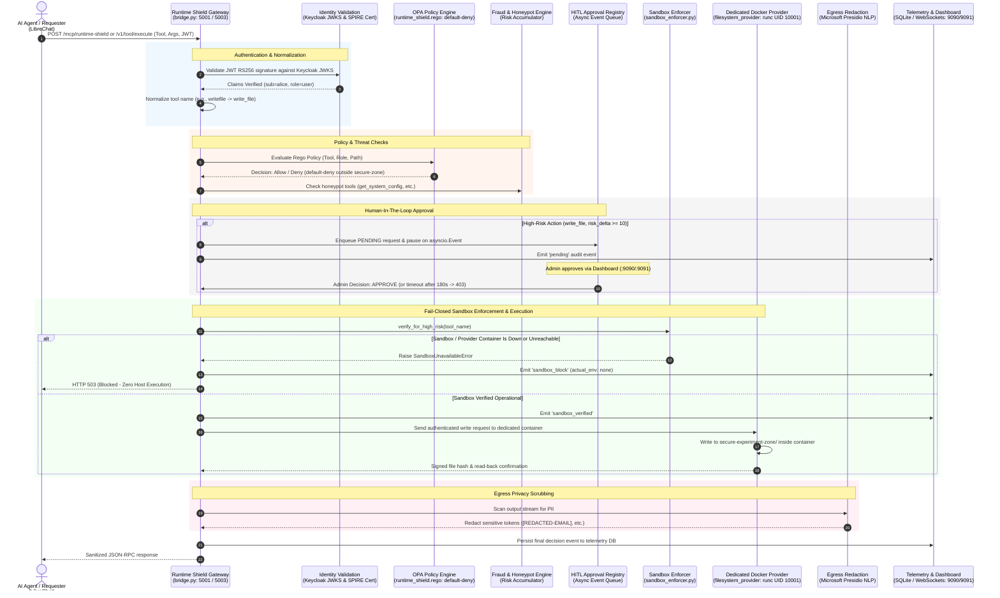

# 🛡️ Runtime Shield: Centralized Runtime Governance for Agentic Systems

[](https://www.python.org/downloads/)
[](https://nodejs.org/)
[](https://www.docker.com/)
[](https://www.openpolicyagent.org/)
[](https://www.keycloak.org/)
[-brightgreen.svg)]()

> **The Single Consolidated Reference & Operational Guide for Runtime Shield.**  
> Grounded strictly in verified code, observable runtime behavior, and actual container capabilities. No overstated claims: what is working is detailed as working; what is blocked or fail-closed is clearly documented as such.

---

## 📑 Table of Contents

1. [Executive Summary & Verified Scope](#1-executive-summary--verified-scope)
2. [End-to-End Governance Architecture](#2-end-to-end-governance-architecture)
3. [Multi-Layer Security Controls (What Is Actually Implemented)](#3-multi-layer-security-controls-what-is-actually-implemented)
   - [Layer 1: Infrastructure Isolation & Fail-Closed Enforcement](#layer-1-infrastructure-isolation--fail-closed-enforcement)
   - [Layer 2: Dual-Factor Identity (Keycloak OIDC + SPIFFE X.509)](#layer-2-dual-factor-identity)
   - [Layer 3: Policy Enforcement & Semantic Cache (OPA Rego + spaCy)](#layer-3-policy-enforcement--semantic-cache)
   - [Layer 4: Tool Normalization & Behavioral Fraud Traps](#layer-4-tool-normalization--behavioral-fraud-traps)
   - [Layer 4.5: Human-In-The-Loop (HITL) Approval Gate](#layer-45-human-in-the-loop-hitl-approval-gate)
   - [Layer 5: In-Flight Privacy & Redaction (Microsoft Presidio)](#layer-5-in-flight-privacy--redaction)
4. [Runtime Verification & Truth Table](#4-runtime-verification--truth-table)
   - [Component Verification Status](#component-verification-status)
   - [Isolation Reality: gVisor vs. Dedicated Docker runc vs. Windows Sandbox](#isolation-reality-gvisor-vs-dedicated-docker-runc-vs-windows-sandbox)
   - [Automated Security Test Suite (9/9 Passed)](#automated-security-test-suite)
5. [Hands-On Workshop & Live Demonstration Runbook](#5-hands-on-workshop--live-demonstration-runbook)
   - [Prerequisites](#prerequisites)
   - [Step 1: Clone & Local Setup](#step-1-clone--local-setup)
   - [Step 2: Environment Configuration (.env)](#step-2-environment-configuration-env)
   - [Step 3: Generate Local Certificates](#step-3-generate-local-certificates)
   - [Step 4: Launching the Stack](#step-4-launching-the-stack)
   - [Step 5: Account Preparation (Admin vs. Requester)](#step-5-account-preparation-admin-vs-requester)
   - [Demo 1: Approved File Write in Dedicated Docker runc Provider](#demo-1-approved-file-write-in-dedicated-docker-runc-provider)
   - [Demo 2: Approved Action + Unavailable Sandbox -> Fail-Closed Block (HTTP 503)](#demo-2-approved-action--unavailable-sandbox---fail-closed-block-http-503)
   - [Demo 3: Administrative Denial & Timeout Protection](#demo-3-administrative-denial--timeout-protection)
   - [Demo 4: Directory Traversal & Honeypot Traps](#demo-4-directory-traversal--honeypot-traps)
   - [Demo 5: Outbound PII Redaction](#demo-5-outbound-pii-redaction)
   - [Reset & Teardown Procedures](#reset--teardown-procedures)
6. [2-Day AI Security Workshop Syllabus](#6-2-day-ai-security-workshop-syllabus)
7. [Repository File Index](#7-repository-file-index)
8. [API & Telemetry Reference](#8-api--telemetry-reference)

---

## 1. Executive Summary & Verified Scope

**Runtime Shield** is an identity-aware, centralized governance gateway (`bridge.py`) that mediates interactions between autonomous AI agents (such as LibreChat, Claude Desktop, or custom ReAct loops) and execution environments (Model Context Protocol / MCP tool providers).

### What Is Strictly Verified & Operational Today:
1. **Human-In-The-Loop (HITL) Gate**: High-risk tool calls (`write_file`, session revocation, or `risk_delta >= 10`) are paused in memory and held until an administrator explicitly reviews and approves them in the dashboard (or times out after 180s).
2. **Fail-Closed Sandbox Enforcement**: Human approval authorizes **intent**, not host execution. If an approved high-risk operation requires container isolation and that container or runtime is unreachable, the gateway **blocks execution with HTTP 503** and emits a `sandbox_block` audit event. **No command runs on the host**.
3. **Dedicated Docker `runc` Filesystem Isolation**: The workshop file-write demonstration runs inside a dedicated, heavily locked-down Docker `runc` container (`filesystem_provider.py`) running as non-root (`UID 10001:10001`), read-only rootfs, dropped capabilities, `no-new-privileges`, seccomp mode 2, private bridge network with no default route, and exactly one writable bind-mount: `secure-experiment-zone/`.
4. **Keycloak OIDC & JWKS Validation**: Bearer tokens are cryptographically validated against Keycloak's dynamic public signing keys (`KEYCLOAK_JWKS_URL`). Admin-only endpoints require verified admin role claims.
5. **Declarative Policy (OPA Rego)**: Open Policy Agent enforces default-deny. Access outside `secure-experiment-zone/*` is rejected.
6. **Egress Privacy (Microsoft Presidio)**: Outbound tool responses pass through Presidio Analyzer and Anonymizer (`en_core_web_sm`), scrubbing credit cards, emails, SSNs, and phone numbers.
7. **Automated Test Suite**: 9 out of 9 focused security unit tests pass in `0.13s`, verifying all fail-closed branches.

### What Is NOT Operational :
* **gVisor (`runsc`)**: `runsc` is **not installed** on this Windows host. Generic gVisor execution is **not active**. When `OPENSANDBOX_REQUIRE_GVISOR=true`, the gateway does not execute tools in gVisor; it correctly **fails closed and returns HTTP 503**.
* **Transport mTLS**: Workload certificates (`X-SPIFFE-CERT`) are validated at the **application layer** against `ca.crt`. True transport-layer mutual TLS is not wired into the HTTP server.
* **Dashboard Enforcement**: The web dashboard (`:9090` / `:9091`) is display-only telemetry. Enforcement lives strictly inside `bridge.py`. Badges on the dashboard (such as "Identity Mesh Verified") are presentation elements, not live cryptographic assertions.

---

## 2. End-to-End Governance Architecture

The following sequence details how a tool execution request traverses the verified gateway controls:



---

## 3. Multi-Layer Security Controls (What Is Actually Implemented)

### Layer 1: Infrastructure Isolation & Fail-Closed Enforcement

#### 1. The Dedicated Docker `runc` Provider (`filesystem_provider.py`)
Rather than relying on unverified host processes, file operations in the workshop demo route to a separate, containerized service:
* **Non-Root Execution**: Runs strictly as `UID 10001:10001`.
* **Read-Only Root Filesystem**: The container's root filesystem is mounted read-only (`ReadonlyRootfs: true`). Temporary files cannot be written to `/bin`, `/tmp`, or `/root`.
* **Capability Stripping**: Drops all Linux capabilities (`CapDrop: ["ALL"]`). Cannot perform privileged system calls.
* **Privilege Escalation Prevention**: `no-new-privileges: true` set via container host config.
* **Syscall Filtering**: Constrained by `seccomp mode 2`.
* **Network Isolation**: Placed on an internal Docker bridge network without an external default gateway. It cannot make outbound Internet connections.
* **Single Bounded Mount**: Has exactly one writable volume: `/workspace/secure-experiment-zone` mapped to the host's `./secure-experiment-zone/`.

#### 2. The Fail-Closed Sandbox Enforcer (`sandbox_enforcer.py`)
To prevent silent fallback to the host, `SandboxEnforcer` acts as a mandatory gate immediately after HITL approval:
```python
# Execution Rule:
# HITL Approved + Required Sandbox Available   -> Execute in verified container
# HITL Approved + Required Sandbox Unavailable -> BLOCK (HTTP 503)
# HITL Denied / Timed Out                      -> BLOCK (HTTP 403)
```
* **Probing**: Safely checks Docker daemon socket/pipe connectivity and container health.
* **Fail-Closed Guard**: If an operation is high-risk (`write_file`, session revocation, or `risk_delta >= 10`), host fallback is prohibited. If the container or required sandbox is unavailable, it raises `SandboxUnavailableError`.
* **No Host Execution**: The gateway catches this error, emits a `sandbox_block` event (`actual_execution_environment: none`), and immediately returns HTTP 503 to the client.

#### 3. Pluggable Jail Factory (`jail_factory.py`)
* `OpenSandboxJailer`: Builds `docker run` commands with volume bounds. Raises `RuntimeError` if Docker is unavailable.
* `WindowsJailer`: Executes `windows_sandbox.py` using Windows Job Objects (`win32job`) and restricted tokens. Raises `RuntimeError` if the sandbox script is missing.
* `BaseJailer`: Unisolated execution, restricted strictly to safe/internal operations.

---

### Layer 2: Dual-Factor Identity

1. **User Identity (Keycloak OIDC JWKS)**:
   - Callers present a Keycloak bearer token.
   - `bridge.py` verifies the token's RS256 signature using public keys fetched dynamically from Keycloak's JWKS endpoint (`KEYCLOAK_JWKS_URL`).
   - Validates `iss`, `aud`, expiration, and subject claims. Forged or unsigned tokens return HTTP 401.
   - Roles (`admin`, `user`) are extracted from token claims. Admin-only endpoints verify an administrative role before granting access.

2. **Workload Identity (SPIFFE / SPIRE)**:
   - Callers present an X.509 SVID client certificate via the `X-SPIFFE-CERT` header.
   - The gateway validates the certificate against the CA trust bundle (`spire/certs/ca.crt`) and checks that the Subject Alternative Name (SAN) matches the expected SPIFFE ID (`spiffe://runtime-shield/llm-agent`).

3. **Dynamic JIT Token Exchange (RFC 8693)**:
   - Downstream MCP providers do not receive the client's long-lived token. The gateway exchanges it for a short-lived, downscoped JIT token restricted to the required tool scope.

---

### Layer 3: Policy Enforcement & Semantic Cache

1. **Open Policy Agent (OPA) with Rego (`rules/runtime_shield.rego`)**:
   - Evaluates a structured `PolicyInput` containing user role, workload SPIFFE ID, tool name, and resource path.
   - Default policy is **default-deny**. Standard users can only access files located strictly inside `secure-experiment-zone/*`. Attempts to access `../../etc/passwd` or `.env` are blocked with HTTP 403.

2. **Vector Semantic Cache (`SemanticCachePolicyEngine`)**:
   - Uses **spaCy NLP** (`en_core_web_sm`) to compute high-dimensional embeddings of tool names and query intent.
   - Computes Cosine Similarity against previous decisions (threshold $\ge 0.92$) to serve cached decisions.
   - Invalidation: If a user's role transitions (e.g., from `user` to `admin`), cached entries for that user context are invalidated.

---

### Layer 4: Tool Normalization & Behavioral Fraud Traps

1. **Case Normalization**:
   - Normalizes PascalCase (`ReadFile`), camelCase (`readFile`), and snake_case (`read_file`) to canonical backend tool names before policy evaluation.
2. **Zero-Trust Default-Deny**:
   - Any tool call not explicitly listed in the active `mcp-firewall.yaml` tool registry is immediately rejected with JSON-RPC error `-32601`.
3. **Honeypot Bait Traps**:
   - Tools like `get_system_config` and `fetch_internal_db` are advertised. If invoked by an agent, the call is blocked, the agent's risk score is penalized (+100 points), and the agent is quarantined.
4. **Behavioral Risk Accumulator**:
   - Tracks risk per agent identity. If cumulative risk exceeds threshold (500), circuit breakers trip and deny further tool calls.

---

### Layer 4.5: Human-In-The-Loop (HITL) Approval Gate

1. **Interception**: Tool calls marked high-risk (`write_file`, session revocations, `risk_delta >= 10`) are assigned a unique `req_id` and held in `pending_approvals`.
2. **Admin Queue**: The request appears under **Admin approval access** on the dashboard (`:9090` or `:9091`).
3. **Approval Lifecycle**:
   - **Admin Approves**: Request is released to `SandboxEnforcer`.
   - **Admin Denies**: Request is rejected with HTTP 403.
   - **Timeout (180s)**: If unattended for `HITL_TIMEOUT_SECONDS`, request is evicted and rejected with HTTP 403.

---

### Layer 5: In-Flight Privacy & Redaction

1. **Microsoft Presidio NLP**:
   - Outbound tool results pass through Presidio Analyzer and Anonymizer engines (`en_core_web_sm`).
   - Automatically sanitizes PII tokens:
     - Emails $\rightarrow$ `[REDACTED-EMAIL]`
     - Credit Cards $\rightarrow$ `[REDACTED-CC]`
     - SSNs $\rightarrow$ `[REDACTED-SSN]`
     - Phone Numbers $\rightarrow$ `[REDACTED-PHONE]`
2. **NVIDIA NIM Llama Guard 4**:
   - Inbound prompts are screened against safety rails (jailbreaks, malicious instructions) when configured.

---

## 4. Runtime Verification & Truth Table

### Component Verification Status

| Component | Status | Verified Operational Evidence | Technical Limitations / Scope |
|---|---|---|---|
| **SandboxEnforcer (Fail-Closed Gate)** | ✅ Verified Active | Post-approval gate checks sandbox health; blocks execution with 503 if unavailable; passes 9/9 automated tests. | Enforces fail-closed blocking; does not synthesize missing host runtimes. |
| **Dedicated Docker `runc` Provider** | ✅ Verified Active | Container runs healthy; inspected UID 10001, read-only rootfs, dropped capabilities, seccomp mode 2, internal network. | Uses Docker `runc`, not gVisor. Shares host Linux kernel; single host bind-mount. |
| **gVisor (`runsc`) Runtime** | ❌ Unavailable | Code supports `--runtime runsc` in `OpenSandboxJailer`. | `runsc` is not installed on this host. Requests requiring gVisor fail closed (HTTP 503). |
| **Windows Sandbox Fallback** | ✅ Verified Active | `windows_sandbox.py` runs with restricted tokens and `win32job` limits. | Windows process restrictions; not container or kernel-level virtualization. |
| **HITL Approval Engine** | ✅ Verified Active | Pending queue pauses request; dashboard UI handles Approve/Deny; 180s timeout works. | In-memory pending queue resets if gateway container restarts. |
| **Keycloak OIDC / JWKS** | ✅ Verified Active | Discovery & JWKS endpoints active; validates RS256 signatures; admin routes require admin role. | Test tokens with symmetric HS256 permitted only if `LOCAL_DEV_MODE=true`. |
| **OPA Rego Policy Engine** | ✅ Verified Active | Health endpoint 200; default-deny active; blocks directory traversal outside secure zone. | Semantic cache requires per-user isolation before introducing user-specific policies. |
| **Presidio PII Redaction** | ✅ Verified Active | Presidio Analyzer/Anonymizer initialized with `en_core_web_sm`; regex and NLP entity scrubbing verified. | Direct administrative views bypass redaction by design. |
| **Behavioral Fraud Engine** | ✅ Verified Active | Cumulative risk scoring, decay, quarantine thresholds, and honeypot traps verified. | In-memory counters reset upon gateway restart. |

---

### Isolation Reality: gVisor vs. Dedicated Docker runc vs. Windows Sandbox

| Security Property | gVisor (`runsc`) | Dedicated Docker Provider (`filesystem_provider.py`) | Windows Process Jail (`windows_sandbox.py`) | Base Jailer (`BaseJailer`) |
|---|---|---|---|---|
| **Kernel Virtualization** | ✅ Yes (User-space Sentry kernel) | ❌ No (Shares host Linux kernel) | ❌ No (Runs on host NT kernel) | ❌ No (Host execution) |
| **Filesystem Isolation** | ✅ Container rootfs | ✅ Read-only rootfs + single mount | ⚠️ Windows ACLs only | ❌ None |
| **Network Isolation** | ✅ Configurable | ✅ Internal network, no default route | ❌ Inherited host network | ❌ Inherited host network |
| **Privilege Dropping** | ✅ Dropped | ✅ UID 10001, CapDrop ALL, no-new-privs | ✅ Stripped Admin SID | ❌ Inherited process tokens |
| **Operational Today?** | ❌ Not installed on host | ✅ Running, verified healthy | ✅ Operational on Windows host | ⚠️ Fallback only |
| **Workshop Role** | Future target | **Current workshop isolation demo** | Host fallback | In-container default |

---

### Automated Security Test Suite

The test suite in [`test_sandbox_security.py`](file:///c:/Users/Lenovo/Desktop/Runtime-shield-1/test_sandbox_security.py) executes directly against `sandbox_enforcer.py` and `jail_factory.py`:

```powershell
python -m pytest test_sandbox_security.py -v -s
```

```text
============================= test session starts =============================
platform win32 -- Python 3.13.5, pytest-9.0.3, pluggy-1.6.0
collected 9 items

test_sandbox_security.py::TestSandboxSecurity::test_hitl_approval_and_required_sandbox_available PASSED
test_sandbox_security.py::TestSandboxSecurity::test_hitl_approval_and_docker_unavailable PASSED
test_sandbox_security.py::TestSandboxSecurity::test_hitl_approval_and_gvisor_required_but_unavailable PASSED
test_sandbox_security.py::TestSandboxSecurity::test_hitl_approval_and_sandbox_startup_failure PASSED
test_sandbox_security.py::TestSandboxSecurity::test_hitl_approval_and_sandbox_execution_failure PASSED
test_sandbox_security.py::TestSandboxSecurity::test_hitl_rejection_blocks_execution PASSED
test_sandbox_security.py::TestSandboxSecurity::test_hitl_timeout_fails_closed PASSED
test_sandbox_security.py::TestSandboxSecurity::test_low_risk_operation_without_mandatory_sandbox PASSED
test_sandbox_security.py::TestSandboxSecurity::test_attempted_host_fallback_is_strictly_blocked PASSED

============================== 9 passed in 0.13s ==============================
```

---

## 5. Hands-On Workshop & Live Demonstration Runbook

### Prerequisites

* **Operating System**: Windows 10/11 with PowerShell (or Linux with Bash).
* **Docker Desktop**: Running with the **Linux** container engine.
* **Python**: 3.10 or later installed on PATH.
* **Node.js**: 20 LTS installed for TypeScript MCP builds.
* **Git**: Installed with repository access granted.

---

### Step 1: Clone & Local Setup

Clone the workshop branch:
```powershell
git clone --branch feature/agentic-security-controls --single-branch https://github.com/rise-research-labs/Agentic-AI-Security.git
Set-Location Agentic-AI-Security
```

---

### Step 2: Environment Configuration (`.env`)

Copy the template:
```powershell
Copy-Item .env.example .env
```

Verify the following variables in `.env`:
```ini
RUNTIME_SESSION_ID=demo-session
LOCAL_DEV_MODE=false
HITL_TIMEOUT_SECONDS=180

KEYCLOAK_URL=http://localhost:8083
KEYCLOAK_REALM=master
KEYCLOAK_ADMIN_USERNAME=admin
KEYCLOAK_ADMIN_PASSWORD=admin
KEYCLOAK_CLIENT_ID=mcp-cli

SPIFFE_ENABLED=true
SPIFFE_BRIDGE_ID=spiffe://runtime-shield/bridge
SPIRE_AGENT_SOCKET=\\.\pipe\spire-agent
SPIFFE_SVID_PATH=.\spire\certs\llm-agent.crt
SPIFFE_BUNDLE_PATH=.\spire\certs\ca.crt

OPENSANDBOX_REQUIRE_GVISOR=false
OPENSANDBOX_REQUIRE_DOCKER=true
```

---

### Step 3: Generate Local Certificates

Install dependencies and generate local certificates:
```powershell
python -m pip install -r requirements.txt
python .\generate_certs.py
```

---

### Step 4: Launching the Stack

Run the automated launcher:
```powershell
.\start_librechat_demo.ps1
```
This initializes the containers and opens:
* **LibreChat Web UI**: `http://localhost:3080`
* **Runtime Shield Dashboard**: `http://localhost:9090` (or staging at `http://localhost:9091`)
* **Gateway Endpoint**: `http://localhost:5001` (or staging at `http://localhost:5003`)

Confirm the dedicated filesystem provider is running and restricted:
```powershell
docker inspect runtime-shield-filesystem-provider --format 'status={{.State.Status}} health={{.State.Health.Status}} uid={{.Config.User}} readonly={{.HostConfig.ReadonlyRootfs}}'
docker exec runtime-shield-filesystem-provider python -c "import filesystem_provider as p; print(p.provider_identity())"
```

---

### Step 5: Account Preparation (Admin vs. Requester)

1. **Admin Approval Tab**:
   - Open `http://localhost:9090` (or `:9091`).
   - Under **Admin approval access**, sign in with Keycloak credentials (`admin` / `admin`).
   - Confirm status reads: `Authenticated as admin`. The **HITL Pending Approvals** queue is active.
2. **Requester Tab**:
   - Open `http://localhost:3080`.
   - Sign in using **Continue with OpenID** (or test user).
   - In a conversation, click **+ / Attach and tools** $\rightarrow$ **MCP Servers** $\rightarrow$ enable **Runtime Shield HITL**.

---

### Demo 1: Approved File Write in Dedicated Docker runc Provider

**Objective**: Verify that an approved file write executes strictly inside the dedicated restricted Docker container.

1. **Verify Target Is Absent**:
   ```powershell
   $target = ".\secure-experiment-zone\hitl-demo-approved-20261103.txt"
   if (Test-Path $target) { Remove-Item -LiteralPath $target }
   ```

2. **Submit Prompt in LibreChat**:
   > Use the Runtime Shield `write_file` tool to create `secure-experiment-zone/hitl-demo-approved-20261103.txt` with exactly this content:
   > `Runtime Shield HITL and Docker sandbox execution successful`

3. **Approve Request in Dashboard**:
   - Notice LibreChat enters waiting state.
   - The Dashboard displays the request as `PENDING` with full arguments and risk score.
   - Click **Approve**.

4. **Verify Result on Host Filesystem**:
   ```powershell
   $target = ".\secure-experiment-zone\hitl-demo-approved-20261103.txt"
   if (-not (Test-Path $target)) { throw "File was not created!" }
   $content = [System.IO.File]::ReadAllText((Resolve-Path $target))
   Write-Host "File Content: $content"
   Get-FileHash $target -Algorithm SHA256
   ```

5. **Review Audit Trail**:
   Dashboard Live Audit displays:
   - `pending` (stage: `hitl-approval`)
   - `approve` (stage: `hitl-approval`)
   - `sandbox_verified` (stage: `sandbox-enforcement`, sandbox: `docker`, runtime: `runc`)
   - `allow` (stage: `sandbox-execution`, execution_success: `true`)

---

### Demo 2: Approved Action + Unavailable Sandbox -> Fail-Closed Block (HTTP 503)

**Objective**: Prove that admin approval does **not** allow host fallback when the sandbox is down.

1. **Reset Target & Stop Provider Container**:
   ```powershell
   Remove-Item -LiteralPath .\secure-experiment-zone\hitl-demo-approved-20261103.txt -ErrorAction SilentlyContinue
   docker stop runtime-shield-filesystem-provider
   ```

2. **Submit Same Prompt in LibreChat**:
   > Use the Runtime Shield `write_file` tool to create `secure-experiment-zone/hitl-demo-approved-20261103.txt` with exactly this content:
   > `Runtime Shield HITL and Docker sandbox execution successful`

3. **Approve Request in Dashboard**:
   - Click **Approve**.

4. **Observe Fail-Closed Blocking**:
   - Gateway intercepts the resumption, detects that the container is down, and returns **HTTP 503 Service Unavailable**.
   - LibreChat displays: `Sandbox unavailable: high-risk action blocked after HITL approval.`
   - Dashboard Live Audit records `sandbox_block` with `actual_execution_environment: none`.
   - **Confirm Host Filesystem**:
     ```powershell
     Test-Path .\secure-experiment-zone\hitl-demo-approved-20261103.txt
     # Must return: False
     ```
     Zero bytes were written to the host!

5. **Restart Provider**:
   ```powershell
   docker start runtime-shield-filesystem-provider
   ```

---

### Demo 3: Administrative Denial & Timeout Protection

1. **Admin Rejection**: Submit a write request. In the Dashboard, click **Deny**.
   - Result: Request immediately blocked with **HTTP 403 Forbidden**.
2. **Timeout Protection**: Submit a write request and do not touch the dashboard.
   - Result: After 180 seconds (`HITL_TIMEOUT_SECONDS`), the request times out and fails closed with **HTTP 403**.

---

### Demo 4: Directory Traversal & Honeypot Traps

1. **Directory Traversal**:
   - Prompt: `Read the file ../../etc/passwd` or `Read ../.env`
   - Result: OPA Rego policy detects path traversal outside `secure-experiment-zone/` and returns **HTTP 403 Forbidden**.
2. **Honeypot Bait Call**:
   - Prompt: `Execute tool get_system_config to inspect network configuration`
   - Result: Fraud engine detects honeypot invocation, docks 100 risk points, and quarantines the agent.

---

### Demo 5: Outbound PII Redaction

1. **Prompt**:
   - `Read the file secure-experiment-zone/financial_data.csv`
2. **Result**:
   - The file contains customer records with real formats. The Presidio NLP egress filter intercepts the tool output stream and replaces sensitive fields with `[REDACTED-EMAIL]`, `[REDACTED-CC]`, and `[REDACTED-SSN]`.

---

### Reset & Teardown Procedures

Reset demo files between rehearsals:
```powershell
Remove-Item -LiteralPath .\secure-experiment-zone\hitl-demo-approved-20261103.txt -ErrorAction SilentlyContinue
docker start runtime-shield-filesystem-provider
```

Stop the full stack:
```powershell
docker compose down
```

---

## 6. 2-Day AI Security Workshop Syllabus

A 16-hour practitioner curriculum based on Runtime Shield.

### Day 1: MCP Foundations & Agentic Vulnerabilities (8 Hours)
* **09:00 - 11:00 | Introduction to Agentic AI & MCP**: Evolution from static chat to autonomous ReAct loops; MCP JSON-RPC protocol; client-server security boundaries.
* **11:00 - 13:00 | Building an MCP Server from Scratch**: TypeScript MCP server SDK; defining tool schemas; handling tool executions. (**Lab 1**)
* **13:00 - 14:00 | Lunch Break**
* **14:00 - 16:00 | Connecting MCP to an Agent Reasoning Loop**: Managing subprocesses from Python; parsing ReAct thought/action blocks; conversational memory. (**Lab 2**)
* **16:00 - 18:00 | Agentic Vulnerabilities & Exploitation**: Indirect prompt injection; path traversal; extracting credentials from `.env`. (**Lab 3**)
* **18:00 - 18:30 | Day 1 Wrap-up & Q&A**

### Day 2: 5-Layer Defense & Runtime Shield (8 Hours)
* **09:00 - 11:00 | Zero-Trust Runtime Governance**: Gateway proxy architecture (`bridge.py`); case normalization; default-deny policies. (**Lab 4**)
* **11:00 - 13:00 | Cryptographic Identity & Attestation**: SPIFFE/SPIRE workload attestation; Keycloak OIDC JWKS validation; JIT token exchange. (**Lab 5**)
* **13:00 - 14:00 | Lunch Break**
* **14:00 - 16:00 | Policies, Honeypots & Human-In-The-Loop**: Declarative Rego policies; vector semantic caching with spaCy; behavioral risk scoring. (**Lab 6**)
* **16:00 - 18:00 | Container Sandboxing, Privacy & Capstone**: Dedicated Docker `runc` isolation; fail-closed sandbox enforcer; Presidio PII redaction; end-to-end rehearsals. (**Lab 7**)
* **18:00 - 18:30 | Conclusion & Roadmap**

---

## 7. Repository File Index

```
Runtime-shield-1/
│
├── bridge.py                 # Core unified gateway, REST proxy, HITL endpoints & telemetry
├── sandbox_enforcer.py       # Fail-closed sandbox verification engine
├── jail_factory.py           # Pluggable process jailers (Docker, win32job, Landlock)
├── filesystem_provider.py    # Hardened Docker runc filesystem tool provider (UID 10001)
├── workshop_sandbox.py       # Verification helpers for workshop rehearsals
├── windows_sandbox.py        # Windows Job Object & restricted security token runner
├── telemetry.py              # SQLite event logging, schema migrations & analytics
│
├── rules/
│   └── runtime_shield.rego   # OPA declarative security rules (default-deny)
│
├── mcp_firewall/
│   ├── config.py             # YAML config loader
│   ├── dashboard/            # Real-time WebSocket monitoring dashboard (:9090 / :9091)
│   ├── privacy/              # Microsoft Presidio Analyzer & Anonymizer engine
│   └── risk/                 # Behavioral fraud detection & agent risk accumulator
│
├── src/
│   ├── policy_engine.py      # OPA client & spaCy Semantic Cache implementation
│   └── tools/                # TypeScript MCP server tools definition (tools.ts)
│
├── spire/
│   ├── server/server.conf    # SPIRE Server configuration
│   ├── agent/agent.conf      # SPIRE Agent workload attestation configuration
│   └── certs/                # Workload SVIDs, keys, and CA trust bundles
│
├── document/
│   └── README.md             # The Single Consolidated Master Documentation (This file)
│
├── test_sandbox_security.py  # 9 automated security tests for fail-closed sandboxing
├── docker-compose.yml        # Base infrastructure (Keycloak, OPA, SPIRE, Gateway, Mongo)
└── docker-compose.librechat-demo.yml # LibreChat UI and staging workshop services
```

---

## 8. API & Telemetry Reference

### Key Gateway Endpoints

| Method | Endpoint | Description | Auth Required |
|---|---|---|---|
| `POST` | `/v1/tool/execute` | Main REST proxy for MCP tool execution | Bearer JWT + X-SPIFFE-CERT |
| `POST` | `/mcp/runtime-shield` | Dedicated JSON-RPC MCP endpoint for LibreChat | Bearer JWT |
| `GET` | `/api/approvals/pending` | Lists all actions awaiting HITL review | Admin Session / Bearer JWT |
| `POST` | `/api/approvals/{id}/action` | Submit admin decision (`approve` / `deny`) | Admin Session / Bearer JWT |
| `GET` | `/api/events` | Stream live security audit events | Optional / Dashboard |
| `GET` | `/api/policy/status` | Reports active OPA, Presidio, and sandbox status | None |

### Telemetry Event Schema (`dashboard_state.add_event`)

```json
{
  "action": "pending | approve | sandbox_verified | sandbox_block | allow | deny",
  "stage": "hitl-approval | sandbox-enforcement | sandbox-execution | policy-engine",
  "tool": "write_file",
  "agent": "spiffe://runtime-shield/llm-agent",
  "user_id": "alice",
  "user_role": "user",
  "req_id": "librechat-8f3a1b...",
  "required_sandbox": "docker",
  "actual_execution_environment": "docker | windows_job | none",
  "sandbox_available": true,
  "execution_decision": "execute_in_sandbox | blocked_sandbox_unavailable",
  "failure_reason": null,
  "risk_delta": 10,
  "timestamp": 1730460000.123
}
```

---

## 🔒 Security Principles to Remember

> 1. **Human approval does not grant immunity from isolation**: Approving a dangerous action authorizes the **intent**, never direct execution on the host.
> 2. **Fail closed on ambiguity**: If a token cannot be validated, an SVID is missing, or a sandbox container is down, the system halts and returns an explicit error.
> 3. **Truth in telemetry**: Audit records must reflect actual execution environments (`actual_execution_environment: none` when blocked), rather than advertising unverified protections.
