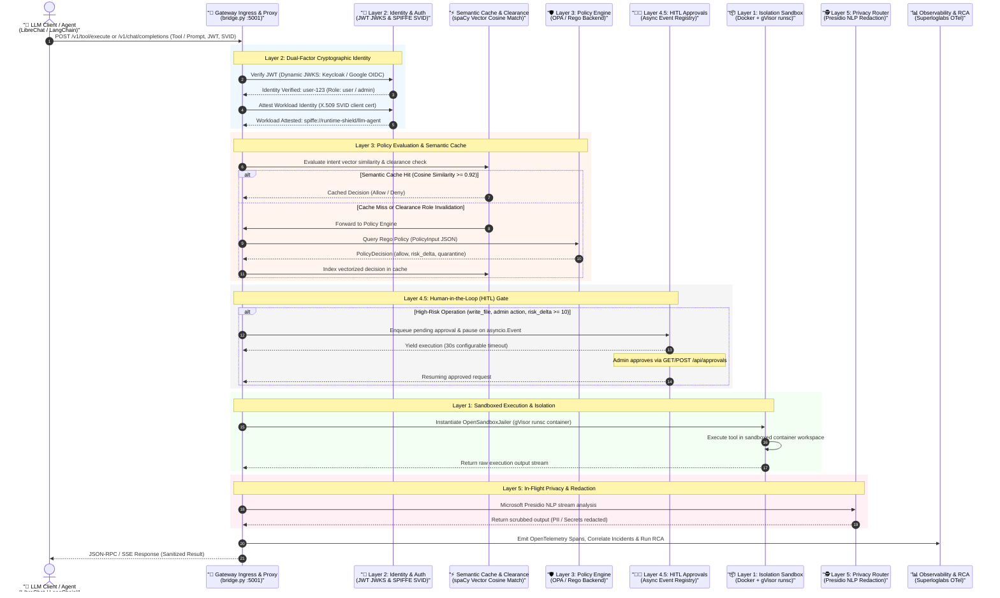

# 🛡️ Runtime Shield: Centralized LLM-Agnostic Runtime Governance for Agentic Systems

[](LICENSE)
[](https://www.python.org/)
[](https://nodejs.org/)
[](https://www.docker.com/)
[](https://www.openpolicyagent.org/)
[](https://opentelemetry.io/)

**Runtime Shield** is a high-performance, identity-aware security gateway providing **Centralized LLM-Agnostic Runtime Governance** for autonomous AI agents (such as LibreChat, Claude Desktop, LangChain/LlamaIndex ReAct loops, and custom agents). 

It acts as a stateful, unified interception gateway between AI clients and execution environments, enforcing **Zero-Trust** boundaries, cryptographically attested workload identities, semantic caching, human approval gates, containerized sandbox isolation, and real-time privacy controls.

---

## 🏗️ Architecture Overview

The diagram below illustrates how an incoming tool call or chat completion traverses the Runtime Shield's defensive layers, semantic cache, OPA policy engine, and HITL approval queue before executing inside an isolated sandbox.



---

## 🛡️ Multi-Layer Defense-in-Depth Mechanics

### 1. Layer 1: Infrastructure Isolation & OpenSandbox
- **Containerized Sandboxing:** Spawns tool execution inside dynamic container environments via [`OpenSandboxJailer`](file:///c:/Users/kavya/OneDrive/Desktop/Runtime-shield-for-agentic-systems/bridge.py) managed by `JailFactory`.
- **gVisor (`runsc`) Virtualization:** Integrates kernel-level virtualization to block direct host syscalls when available.
- **Path Isolation:** Mounts active workspace folders read-write while locking external shared paths and sensitive volumes to read-only mounts. Fallback support includes Windows Job Objects and Linux namespace jails.

### 2. Layer 2: Dual-Factor Identity & Cryptographic Auth
- **User Identity (JWKS Verification):** Dynamic RS256/HS256 JWT validation supporting:
  - **Keycloak IAM:** Dynamic realm signature and claims verification (`iss`, `exp`, `aud`, roles).
  - **Google OIDC / OAuth2:** Dynamically fetches Google's public JWKS certs (`https://www.googleapis.com/oauth2/v3/certs`) and maps emails against `GOOGLE_ADMIN_EMAILS` into fine-grained roles (`admin`, `privileged`, `user`).
- **Workload Identity (SPIFFE / SPIRE):** Validates X.509 SVID client certificates presented in headers (`X-SPIFFE-CERT`) attested against the local CA trust bundle (`ca.crt`).

### 3. Layer 3: Pluggable Policy Enforcement, Semantic Caching & Clearance Check
- **OPA / Rego Declarative Engine:** Standardizes every request into a unified `PolicyInput` schema evaluated against [`rules/runtime_shield.rego`](file:///c:/Users/kavya/OneDrive/Desktop/Runtime-shield-for-agentic-systems/rules/runtime_shield.rego).
- **Semantic Caching ([`SemanticCachePolicyEngine`](file:///c:/Users/kavya/OneDrive/Desktop/Runtime-shield-for-agentic-systems/src/policy_engine.py)):**
  - Uses local **spaCy** NLP (`en_core_web_sm`) to compute high-dimensional vector embeddings of incoming tool names, intents, and arguments.
  - Performs **Cosine Similarity** matching (threshold $\ge 0.92$) against indexed decisions to serve instant cache hits, minimizing latency.
- **Clearance Filter (Dynamic Invalidation):** Tracks user role state. If a user's clearance transitions (e.g. role upgraded from `user` to `admin`), all cached entries for that user are instantly invalidated to prevent privilege escalation.

### 4. Layer 4: Behavioral Fraud Engine & Circuit Breakers
- Tracks cumulative workload risk scores in real-time across sliding time windows.
- Deploys **Honeypot Traps** (`get_system_config`, `fetch_internal_db`) that instantly flag and trap malicious agent exploration.
- **Circuit Breaker:** Automatically trips and quarantines any agent exceeding the risk threshold (`QUARANTINE_THRESHOLD = 500`), revoking its SVID.

### 5. Layer 4.5: Human-in-the-Loop (HITL) Approval System
- Intercepts sensitive or high-risk tool invocations (e.g., `write_file`, privilege changes, risk score $\ge 10$).
- Pauses agent execution asynchronously via `asyncio.Event` (configurable 30s timeout, fails closed on timeout).
- Exposes approval APIs and dashboard controls:
  - `GET /api/approvals/pending` — Lists all pending requests with tool arguments, risk scores, and user metadata.
  - `POST /api/approvals/{req_id}/action` — Allows administrators to approve, deny, or block actions in real-time.

### 6. Layer 5: Privacy Router & PII Redaction
- In-flight JSON-aware and streaming PII scrubbing using **Microsoft Presidio NLP**.
- Redacts credit card numbers, SSNs, personal emails, phone numbers, and secrets before LLM ingestion or user display.

### 7. Observability, OpenTelemetry & Superloglabs RCA
- **OpenTelemetry Standard:** Emits structured spans, traces, and metrics via `SuperloglabsExporter`.
- **Incident Correlation:** Aggregates repeated alerts within a 5-minute sliding window into unified incident records in SQLite (`telemetry.db`).
- **Automated Root Cause Analysis (RCA):** Analyzes blocked actions and policy violations to generate automated diagnostic reports and suggested PR patches.

---

## 📁 Codebase Structure

```text
├── bridge.py                 # Core unified gateway, REST proxy, HITL endpoints & OpenSandbox jailer
├── telemetry.py              # OpenTelemetry exporter, incident correlation & RCA engine
├── login.py                  # Authentication CLI & mock token generator (Keycloak / Google)
├── run_security_drills.py    # Automated policy & security compliance test suite
├── mcp-firewall.yaml         # Operational firewall rules, tool definitions & scopes
├── Dockerfile                # Multi-stage production build (Node.js TypeScript + Python 3.11)
├── docker-compose.yml        # Orchestration for Keycloak, SPIRE, Gateway, and Chatbot
│
├── src/
│   ├── index.ts              # TypeScript MCP server entrypoint
│   ├── policy_engine.py      # OPA engine & SemanticCachePolicyEngine implementation
│   ├── opa_sync.py           # Syncs firewall rules into OPA JSON data
│   └── tools/                # Built-in tool implementations
│
├── rules/
│   ├── runtime_shield.rego   # Rego declarative policy rules for OPA
│   └── runtime_shield_data.json # Synchronized policy dataset
│
├── spire/                    # SPIFFE/SPIRE server, agent, and certificate configurations
└── document/                 # Deep-dive architecture and governance walkthroughs
```

---

## 🚀 Getting Started

### Prerequisites
- **Python 3.10+**
- **Node.js 18+**
- **Docker & Docker Compose**
- **SPIRE** (optional for local mock mode, required for full mTLS SVID attestation)

---

### Option A: Complete Docker Compose Deployment (Dokploy Ready)

Deploy the entire runtime stack (Keycloak, SPIRE Server, SPIRE Agent, Gateway, and Chatbot UI):

```bash
# 1. Clone repository
git clone https://github.com/kavyaa06/Runtime-shield.git
cd Runtime-shield

# 2. Configure environment
cp .env.example .env
# Edit .env with your LLM API keys and secrets

# 3. Create network (if deploying on Dokploy or standalone)
docker network create dokploy-network || true

# 4. Launch all services
docker compose up --build -d
```

#### Running Services:
| Service | Port | Description |
| :--- | :--- | :--- |
| **Runtime Shield Gateway** | `5001` | REST proxy & tool execution gateway (`/v1/tool/execute`) |
| **Security Dashboard** | `9090` | Real-time monitoring & HITL approvals |
| **SSE Bridge** | `5002` | Server-Sent Events MCP bridge |
| **Chatbot UI (Streamlit)** | `8501` | Interactive agent testbed |
| **Keycloak IAM** | `8083` | Identity Provider & JWKS token issuer |

---

### Option B: Local Development Launch

#### 1. Setup Python & Node Dependencies
```bash
# Install Python packages
pip install -r requirements.txt
python -m spacy download en_core_web_sm

# Build TypeScript MCP Server
npm install
npm run build
```

#### 2. Launch with One Command
On Windows (PowerShell):
```powershell
.\run_shield_demo.ps1
```

On Linux / macOS:
```bash
chmod +x run_shield_demo.sh
./run_shield_demo.sh
```

---

## 🧪 Security & Compliance Drills

Run the automated security test suite to validate all layers (path traversal guardrails, RBAC, honeypot traps, and PII redaction):

```bash
python run_security_drills.py
```

### Verification Suite Results Example:
```text
==========================================================================================
🛡️  RUNTIME SHIELD: POLICY VERIFICATION COMPLIANCE REPORT
==========================================================================================
Result: 10/10 drills passed.

Category                 | Test Case                                  | Expected   | Status  
------------------------------------------------------------------------------------------
Directory Traversal      | Traverse to etc/passwd as standard user    | Blocked    | 🟢 PASSED
Directory Traversal      | Access secure-experiment-zone as user      | Allowed    | 🟢 PASSED
Role-Based Access Control| Call GetActiveConnections as standard user | Blocked    | 🟢 PASSED
Role-Based Access Control| Call GetActiveConnections as admin user    | Allowed    | 🟢 PASSED
Sensitive Config Files   | Read .env file as user                     | Blocked    | 🟢 PASSED
Sensitive Config Files   | Read .env file as admin                    | Blocked    | 🟢 PASSED
Honeypot Interception    | Query get_system_config honeypot tool      | Blocked    | 🟢 PASSED
Honeypot Interception    | Query fetch_internal_db honeypot tool      | Blocked    | 🟢 PASSED
Privileged Role Verif.   | Run scanner tool ScanSecrets as privileged | Allowed    | 🟢 PASSED
Privileged Role Verif.   | Run scanner tool ScanSecrets as user       | Blocked    | 🟢 PASSED
==========================================================================================
```

---

## 🔑 Human-in-the-Loop (HITL) API Reference

When high-risk tool calls are paused by the gateway, administrators can query and approve actions via the REST API or UI Dashboard:

### 1. List Pending Approvals
```http
GET /api/approvals/pending HTTP/1.1
Host: 127.0.0.1:9090
```
**Response:**
```json
[
  {
    "req_id": "req-9b8c2f10",
    "tool_name": "write_file",
    "tool_args": {"path": "config.json", "content": "..."},
    "user_id": "user-482",
    "user_role": "user",
    "risk_score": 15,
    "status": "pending",
    "timestamp": 1756819200
  }
]
```

### 2. Action an Approval (Approve / Deny / Block)
```http
POST /api/approvals/req-9b8c2f10/action HTTP/1.1
Host: 127.0.0.1:9090
Content-Type: application/json

{
  "action": "approve"
}
```
*Valid actions: `"approve"`, `"deny"`, `"block"`.*

---

## ⚙️ Configuration Reference

Key configuration settings in `.env`:

| Variable | Default | Description |
| :--- | :--- | :--- |
| `POLICY_BACKEND` | `opa` | Policy engine backend (`opa` / `local`) |
| `OPA_URL` | `http://127.0.0.1:8181/v1/data/runtime_shield` | OPA decision endpoint |
| `KEYCLOAK_URL` | `http://127.0.0.1:8083` | Keycloak Identity Provider URL |
| `GOOGLE_ADMIN_EMAILS`| `admin@example.com` | Comma-separated Google emails mapped to `admin` role |
| `SPIFFE_ENABLED` | `true` | Enforces cryptographic SPIFFE/SPIRE workload attestation |
| `SPIFFE_BUNDLE_PATH` | `./spire/certs/ca.crt` | Trust bundle for validating SVID certs |
| `QUARANTINE_THRESHOLD` | `500` | Cumulative risk score threshold before auto-quarantine |
| `HITL_TIMEOUT_SECONDS` | `30.0` | Timeout for pending human approval before failing closed |

---

## 🤝 Contributing & License

Contributions are welcome! Please open an issue or pull request for review.

Distributed under the **MIT License**. See `LICENSE` for more information.
