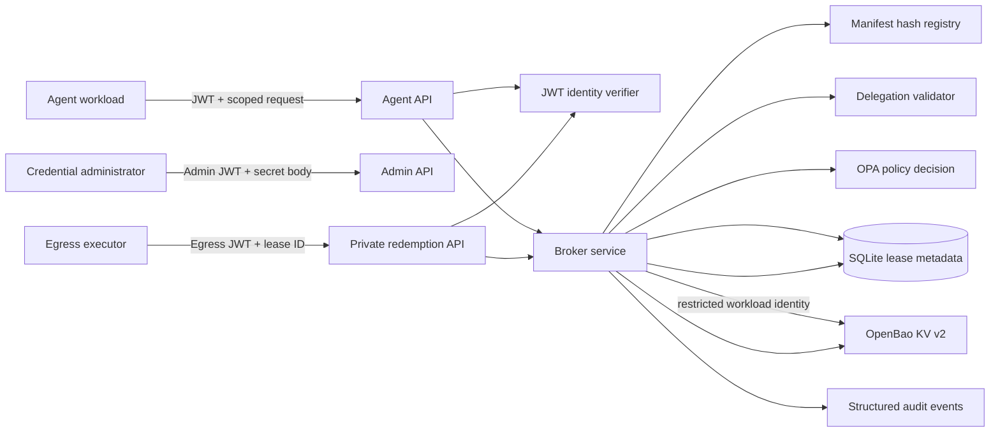

# Architecture and security model

## Components

## Trust boundaries and data flow

1. An administrator authenticates with the admin audience and writes a secret request body. The admin route validates alias syntax and sends data directly to OpenBao; it emits no secret payload in responses or audit records.
2. An agent authenticates using signed identity claims. Identity and workload are derived from verified JWT claims, never request JSON.
3. The broker validates alias/schema, checks the manifest digest against configured trusted registrations, validates supplied delegation attenuation, and asks OPA for a decision. Any OPA failure is deny.
4. After allow, the broker confirms alias availability through OpenBao, records a bounded internal lease in SQLite, and returns only metadata. No credential is returned to the agent.
5. The egress service authenticates independently using its egress JWT. The lease use is atomically checked/consumed before the broker fetches the OpenBao value. The lease workload binding must match the verified egress workload.
6. Audit records identify the operation and outcome without including secret values or vault tokens.

## Credential and lease lifecycle

Credentials are written to `runtime-shield/data/credentials/{alias}` in OpenBao KV v2. The API accepts aliases only; OpenBao paths stay internal. Rotation uses an overwrite of the alias and OpenBao versioning. Deletion removes the latest KV v2 version through the data endpoint; configure metadata deletion/retention separately if permanent purge is required.

A broker lease captures agent/workload, alias, tool, operation, resource, manifest digest, delegation ID, policy decision reference, timestamps, use count, state, and egress workload binding. Default uses are one and duration is at most configured maximum. Internal expiration prevents future redemption; it does not revoke a static upstream token. OpenBao dynamic secret lease expiry and upstream OAuth/API expiry are separate lifecycles and are not implemented here.

## Authorization

OPA is the source of authorization decisions. `policies/credential.rego` denies by default and checks subject, alias, tool, operation, resource, manifest, duration, and delegation constraints against data. The sample `data.json` is development-only sample policy data, not a general policy. Production must load managed policy and data out of band, use authenticated OPA transport, and set `ALLOW_LOCAL_POLICY=false`. The application never trusts an `authorized` input field.

## Manifest integrity and delegation

Manifest hashes use UTF-8 JSON with sorted keys, compact separators, and non-ASCII preserved, prefixed by `sha256:`. Only registered digests are accepted. This proves equality with a registered digest only; it does not prove that the runtime tool implementation matches the manifest.

Delegation binds parent, child, ID, optional parent reference, allowed operations/resources, expiry, and depth. The broker checks child identity, requested operation/resource, expiry, and configured depth. A production OPA policy/data source must independently verify the delegation chain and parent authority; this service's local checks do not establish parent permissions cryptographically. OPA must enforce privilege attenuation at each chain edge.

## OpenBao configuration

The broker needs only the credential mount's KV v2 data read/write/delete capabilities and metadata read/delete only if operationally required. Use dedicated AppRole with response wrapping/short-lived SecretIDs or platform workload identity. Never use root credentials in production. Local development may use a disposable dev token with isolated storage. OpenBao audit devices should be enabled and their logs protected; broker audit logs do not replace OpenBao audit.

## Threat model and operational controls

Protected assets: upstream credentials, OpenBao auth, identity tokens, policy and lease integrity. Untrusted inputs include agent requests, lease IDs, aliases, tool metadata, and delegation payloads. Controls include separate audiences, deny-by-default OPA, strict schema checks, manifest allowlist, workload-bound one-use leases, generic errors, rate limiting, correlation IDs, and secret-free audit events.

Required deployment controls include TLS, private service networking, egress-only redemption reachability, hardened identity issuance, restricted OpenBao policies, OPA transport/authentication, secret rotation, database protection, append-only audit collection, monitoring, backups, and periodic penetration testing. App-level rate limiting in this starter uses client address and should be replaced or supplemented by gateway limits and identity-based quotas.

## Development container startup

The Docker Compose configuration is local development only. OpenBao uses file storage on its own named volume and runs as the image's non-root user; initialization, unsealing, KV setup, and AppRole setup are operator controlled. `data-init` fixes the named SQLite volume ownership to UID/GID 10001 before the non-root broker starts. OPA's sample data has a single development principal and a fixed manifest digest; production config rejects local development auth, static OpenBao tokens, and local/non-HTTPS OPA endpoints.
